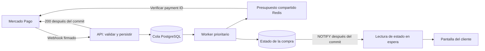

# Confirmación de pagos con solicitudes acotadas

## Flujo implementado



El webhook ya no depende de la latencia del proveedor. Firma, query y cuerpo se validan antes de persistir. Un fallo al guardar no devuelve aceptación. El cuerpo del webhook y los parámetros del navegador nunca aprueban una compra: se mantienen la verificación oficial de ID, referencia, importe y moneda, las transacciones y la protección del stock.

`PAYMENT_NOTIFICATION_EVENTS` deduplica por identidad del evento, pago y acción; si no se recibió un ID de evento se usa la identidad de entrega firmada. `PAYMENT_NOTIFICATIONS` agrupa versiones por pago. Una actualización recibida mientras hay una verificación en curso queda pendiente. Cada worker procesa como máximo dos pagos diferentes en paralelo, siempre dentro del presupuesto global. Cada instancia toma un bloqueo de sesión PostgreSQL por pago, sin mantener una transacción abierta durante la red. Los fallos se reprograman con espera creciente y variación aleatoria; un reinicio conserva el trabajo. La limpieza de recibos procesados antiguos se hace al despertar la cola, sin sondeo cuando no hay trabajo. Los resultados incompatibles o sin orden se registran para revisión y no generan un bucle infinito de verificaciones.

## Presupuesto configurable

Valores iniciales de `PaymentTracking` (son una política conservadora de esta aplicación, no límites publicados de Mercado Pago):

| Parámetro | Valor | Uso |
|---|---:|---|
| `ProviderRequestsPerMinute` | 60 | Máximo total por minuto para una credencial, compartido entre instancias |
| `BackgroundRequestsPerMinute` | 30 | Techo para conciliación ordinaria; deja capacidad disponible para avisos, recuperaciones y nuevos checkouts |
| `ProviderBurst` | 4 | Capacidad del limitador de ráfagas; la recarga sigue el presupuesto por minuto |

Redis usa su reloj y operaciones atómicas. Las claves incluyen sólo un hash de la credencial. Si Redis no está disponible se difiere el trabajo, sin disparar consultas sin control. El transporte aplica el límite a cada HTTP real y desactiva los reintentos ocultos del SDK. Un 429 pausa todas las instancias de esa credencial, respetando `Retry-After` en segundos o fecha (hasta 24 horas; 30 segundos si falta). Se reserva un presupuesto por credencial; subirlo requiere observar el volumen real, la antigüedad de las colas y los 429. La reserva es un techo para respaldo, no una garantía de capacidad mínima bajo saturación sostenida de trabajo urgente.

El cliente HTTP tiene un timeout de 10 segundos. Al crear un checkout, una cuota agotada devuelve 503 `PAYMENT_BUSY` y `Retry-After`; la transacción de creación se revierte.

## Recuperación al regresar del checkout

`POST /api/checkout/orders/{id}/recover-payment` exige JWT y propiedad de la orden. Sólo programa trabajo para preferencias vigentes y no llama al proveedor dentro del controlador. Un UPDATE condicional compartido permite como máximo dos intentos acelerados en toda la vida de una orden, independientemente de las pestañas o instancias. Respeta al menos 30 segundos desde una consulta reciente; el segundo intento queda a 30 segundos del primero. Después vuelve al backoff habitual. La recuperación también respeta el presupuesto global.

La pantalla solicita esta recuperación al regresar a una pestaña o cuando la URL de retorno contiene indicadores del checkout. Esos indicadores sólo despiertan la cola. Los datos del pago se obtienen de la preferencia guardada, no de los IDs o estados del navegador.

## Actualización visual

`GET /api/order/{id}?watch=true&afterStatus=...` conserva la autenticación y el filtro de dueño, devuelve `Cache-Control: no-store` y puede esperar hasta 20 segundos por una notificación de PostgreSQL. No consulta Mercado Pago ni mantiene una conexión de base abierta mientras espera. Cuando cambia el estado responde inmediatamente. Es una espera HTTP larga, no un WebSocket/SSE, y reutiliza el bearer y el tracker compartido existentes. No agregar caché de proxy a este endpoint; el timeout del proxy debe superar 20 segundos.

El frontend mantiene una sola lectura por orden y pestaña, la cancela al ocultarse/perder conexión/cerrar sesión y mantiene el backoff ante errores o con un backend sin soporte de espera. El límite de 30 segundos para volver a abrir Mercado Pago se conserva y es independiente de la verificación.

## Observabilidad y alcance

- Logs correlacionados por pago y orden: recepción persistida, versión procesada, resultado y próxima fecha.
- Aprobación informada por Mercado Pago y hora de persistencia de la compra.
- Latencia entre recepción y procesamiento del aviso.
- Meter `PaymentGateway.Payments.Transport`: `payment.provider.http.requests` cuenta HTTP admitidos y `payment.provider.deferred` cuenta diferimientos del presupuesto. Las métricas `PaymentGateway.Payments` conservan los intentos por operación del SDK, incluidos los que terminan diferidos.

Estos cambios eliminan la espera del backoff para un webhook válido, pero no pueden anticipar una aprobación que Mercado Pago aún no publicó ni compensar una URL de webhook inaccesible. Revisar entrega, rechazos de firma y latencias reales en el dashboard del proveedor.

## Despliegue y verificación

1. Aplicar `20261028234328_DurablePaymentNotifications` antes de iniciar el backend actualizado. Agrega tablas de recibos/cola, índices, el trigger de despertar y dos columnas en órdenes; no confirma pagos históricos.
2. Reiniciar el backend y publicar el frontend juntos. Todas las instancias deben usar el mismo PostgreSQL y Redis. El listener comprueba que existan ambos triggers requeridos al arrancar.
3. Mantener `Store:WebhookUrl` como HTTPS público estable y `MercadoPago:WebhookSecret` de la aplicación correcta.

Desde `Backend/PaymentGateway`:

```bash
dotnet ef database update --project PaymentGateway.Infrastructure --startup-project PaymentGateway.API
```

Desde la raíz del repositorio, las verificaciones usan proveedor y correos simulados, una base temporal y claves Redis aisladas:

```bash
dotnet build Backend/PaymentGateway/PaymentGateway.SecurityChecks --no-restore -m:1
dotnet run --project Backend/PaymentGateway/PaymentGateway.SecurityChecks --no-build --no-restore -- --database --redis
```

Se prueban recepción sin llamar al proveedor, deduplicación concurrente, actualizaciones durante el procesamiento, reintentos, bloqueos entre instancias, presupuesto global, 429, recuperación limitada, aislamiento de clientes y lecturas que despiertan al confirmar un cambio. No se envían pagos ni correos reales.
